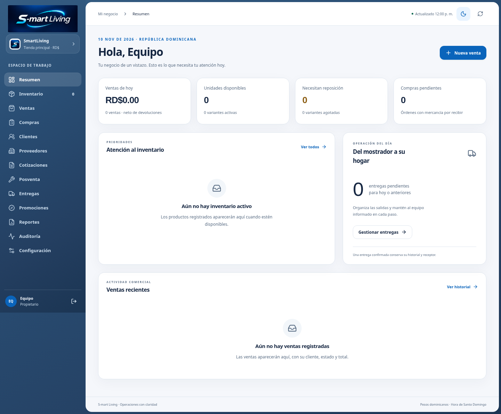
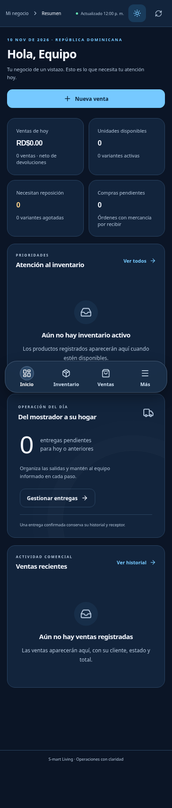

# Phase 5: S-mart Living application shell

This first slice integrates the approved S-mart Living v1.0 starter into the existing React application. Inventory 2.0, Sales 2.0, Purchases & Deliveries 2.0, and GPS work remain outside this change.

## Implementation

- Original PNG brand assets are copied unchanged from `S-mart_Living_Phase5_Integration_Starter.zip`.
- Semantic tokens, reusable React primitives, and CSS are installed after the legacy stylesheet.
- The authenticated shell has a full-height Seamless Glass sidebar, 6px desktop frame, solid content surfaces, and a mobile Quiet Glass Dock at widths up to 850px.
- Existing permission flags control sidebar and dock visibility. Inventory staff receive the purchasing tab; viewers receive no sales or purchasing tab. All sections remain accessible through Más according to existing permissions.
- Appearance defaults to the system preference and persists the user's light/dark selection when browser storage is available. The theme is scoped to the authenticated shell; authentication and session-loading screens retain their existing design.
- The mobile menu contains keyboard focus, moves focus to its close control, supports Escape, prevents background interaction/scrolling, restores the trigger, and releases the modal state when resized to desktop.
- Compatibility CSS makes legacy shared forms, dialogs, statuses, and transaction surfaces readable in either theme without replacing their components or calculations. Deep feature redesign remains deferred.
- Reduced motion, reduced transparency, missing backdrop-filter support, forced colors, safe areas, and paper colors have explicit styles. Mobile notifications sit above the dock.
- Vercel's SPA rewrite excludes `/brand/` so PNG requests are not rewritten to HTML. Backend destinations and production configuration remain unchanged.

## Local verification — 10 November 2026

Node 24.22.1, npm 11.9.0. The guarded starter preflight and its patch tests passed before application.

```sh
npm ci --cache /tmp/inventory-npm-cache --no-audit --no-fund
VITE_SUPABASE_URL=https://example.supabase.co \
VITE_SUPABASE_PUBLISHABLE_KEY=sb_publishable_ci_placeholder npm run check
```

Both public environment values above are the repository's synthetic CI configuration, not a usable backend. No production credentials were used.

Results:

- Lint, TypeScript, and Vite production build passed.
- 201 unit tests passed in 13 files, including 8 new shell regressions. Tests cover all five role profiles and deliberately mismatched role/permission fixtures to confirm that permission flags remain authoritative.
- Local PGlite database tests: 6 passed, 0 failed, 1 optional sanitized legacy-profile test skipped. Existing database suites reported 310 assertions/checks across retail, legacy import, document lifecycle, and master versions. No remote database is used.
- `git diff --check` passed. No dependency, lockfile, SQL migration, transaction, authentication, or provider changes are included.

Browser verification used Chromium/Playwright and axe-core against the **real Shell and operational components** with a temporary, ignored `.private` harness supplying synthetic RetailContext data. All non-loopback browser requests were intercepted and aborted, including legacy Google Fonts. The harness is not imported by the application, build, or deployment. These checks do not establish remote authentication or transaction behavior.

- Dashboard layout: 320, 390, 768, 1024, and 1440px in both themes, without horizontal document overflow.
- axe WCAG 2 A/AA, 2.1 AA, and 2.2 AA scans: zero reported violations across those ten dashboard views, five role-specific open drawers, and a dark product editor dialog. Automated scans do not replace screen-reader or real-device review.
- Mobile role-specific tabs, initial focus, Tab/Shift+Tab containment, Escape, focus restoration, background inert state, and resize cleanup passed.
- Refresh still invokes the context refresh action. Short-height desktop navigation scrolls while the user/logout controls remain reachable.
- Dark product fields use a dark surface and legible text. Print media removes dock and mobile page padding and restores paper colors.
- System dark preference, persisted light preference, and blocked-storage fallback/toggling passed. All 13 existing sections rendered without horizontal document overflow at 320px and 1440px in dark mode using synthetic data.
- The real sale-receipt component rendered a synthetic RD$224.20 receipt in dark mode, then printed with a white surface, dark table text, visible content, and the preserved total. A local PDF was generated; physical printers were not tested.
- Brand asset requests returned HTTP 200 with `image/png` locally. All four copied brand files match the starter byte for byte.
- No uncaught browser errors in the tested flows.

Synthetic local screenshots:





## Remaining review gates

Keep the pull request in draft. Do not merge, deploy to production, assign production domains, or run database migrations for this slice.

Before approval, test login, recovery, logout failure/retry, real role/cost boundaries, commands, receipts, delivery updates, and authorization revocation against a dedicated **non-production Supabase project**. No staging project or credentials were available during local review. Existing server-side regression tests passed; authenticated end-to-end behavior is not claimed.

Also review with a screen reader, actual mobile safe areas/keyboard, reduced transparency/forced colors, and physical receipt printers. Media-query styles are present, but real-device and assistive-technology behavior has not been certified.

## Remote delivery status

The environment blocks `api.github.com` with HTTP 403 at the CONNECT proxy, including GitHub GraphQL. Git repository read access and the feature-branch push dry run succeeded; that does not establish API access. Draft PR creation is blocked until GitHub API network access is available.

No Vercel token, CLI authentication, linked project metadata, or Vercel connector is available in this environment. An automatically generated branch preview may exist after pushing, but its URL, build status, deployment target, exact commit, and backend bindings must be verified before reporting it as ready. The preview must use non-production backend resources for functional QA. The existing CSP names the production backend explicitly; staging access requires a preview-specific CSP for the actual staging hostname rather than weakening the production policy.
